# Analysis

## Low CO2 Did Not Appear To Improve Phragmites australis gsw

The intent of our low-CO2 periods between ramps was to open stomata, increasing gsw (Mott 1988; see the [Literature Cited](../README.md#literature-cited)).

We became excited about this approach after testing it on Morella cerifera. Our initial approach involved testing whether blue light (Shimazaki et al. 2007) and/or reduced CO2 would increase gsw.

Here's a snapshot of how Morella was behaving for us at first. This was a leaf we left running for many hours overnight, but it's a roughly representative slice of what we saw broadly: gsw 0-0.05 everywhere we looked on Morella around the field station. At 420ppm CO2, VPD = 1 kPa, leaf temp = 25C, 800 µmol m⁻² s⁻¹, this Morella leaf was mostly parked around a gsw of 0.02, which is very very low. This is maybe one-tenth as much gsw as you would expect from a vigorously participating leaf.

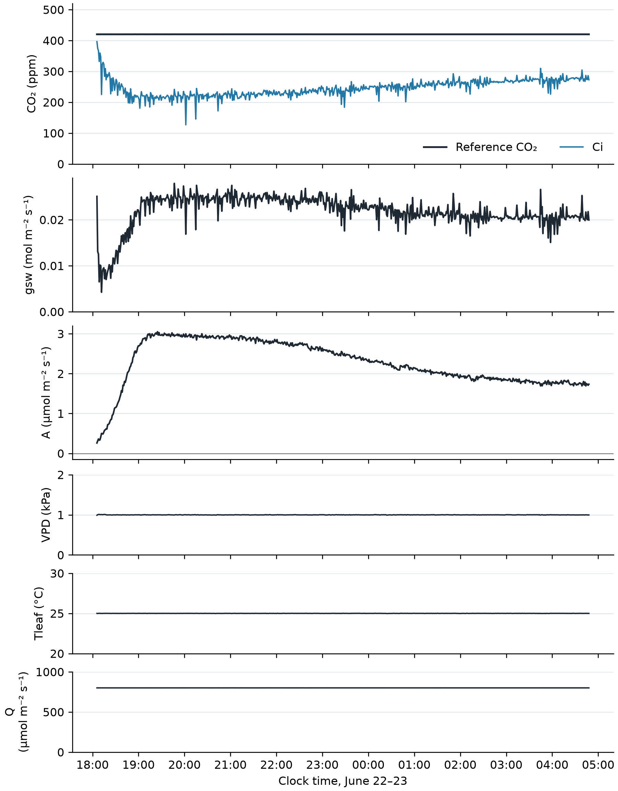

*Morella cerifera, cut branch indoors, June 22–23 ([log](../data/2026-06-22-1756_logdata_morcer_indoor_overnight)), Script: [plot_morella_overnight_steady.py](../scripts/plot_morella_overnight_steady.py).*

We were also finding relatively low rates of carbon assimilation in A/Ci and A/Q curves on Morella:

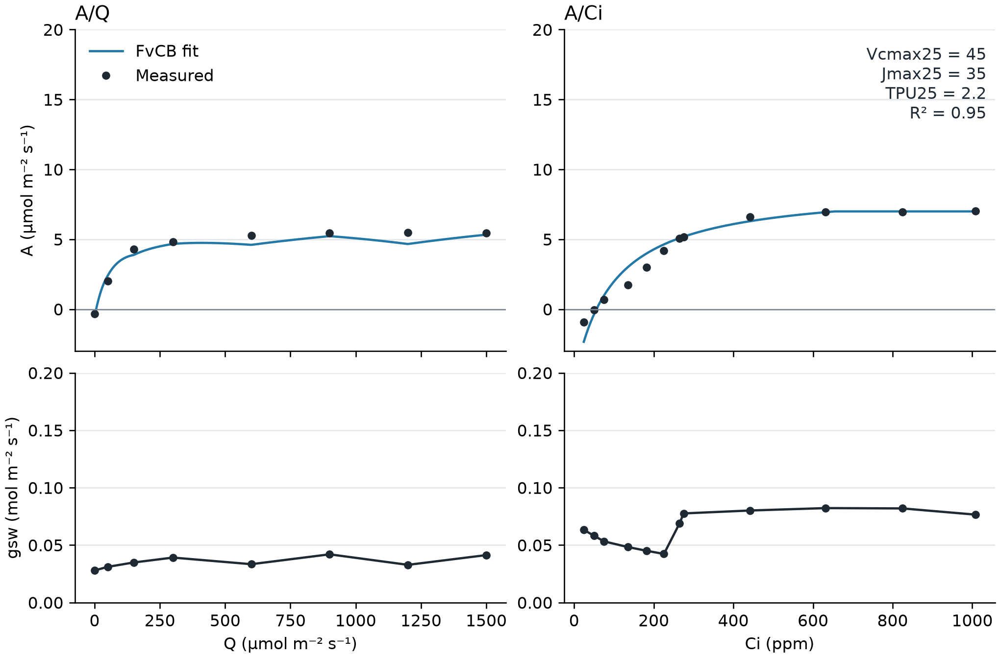

*Morella cerifera, June 15 ([A/Q log](../data/2026-06-15-1020_logdata_morcer_test1), [A/Ci log](<../data/2026-06-15-1053_logdata_morcertest2_Acicurve (1)>)), Fit: [fit_morella_photorch.py](../scripts/fit_morella_photorch.py) ([parameters](../outputs/morella_photorch_june_primary_summary.csv)). Script: [plot_morella_initial_curves.py](../scripts/plot_morella_initial_curves.py).*

We fit the standard FvCB model of photosynthesis but it produced suspicious parameter values. Jmax isn't usually below Vcmax.

gsw and Ci can be unreliable at low values. See [Inherited Vulnerabilities In The Methods](../README.md#inherited-vulnerabilities-in-the-methods) in the README. We set out to increase gsw, and tried making the light bluer and the CO2 lower. Here's one of our tests for low CO2 and blue light: 

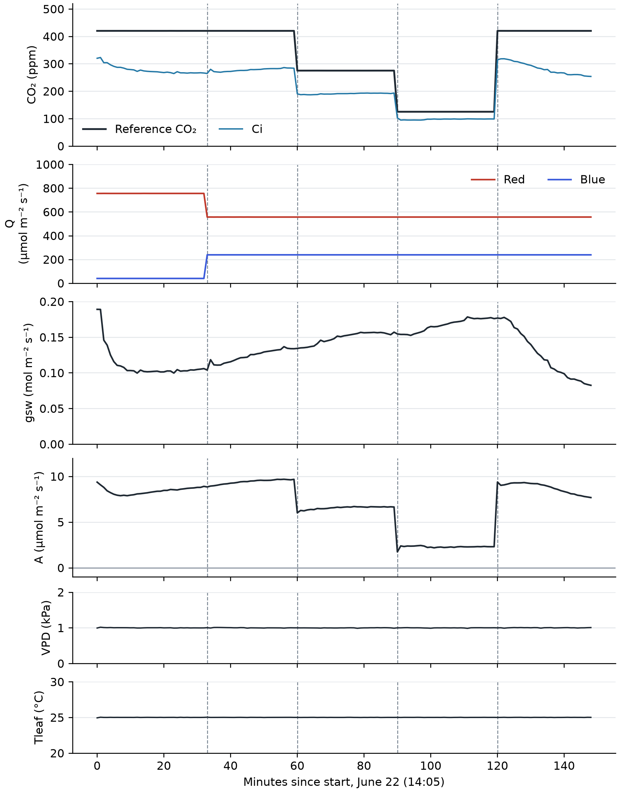

*Morella cerifera, cut branch indoors, June 22 ([log](../data/2026-06-22-1405_logdata_morcer_afternoon_bluelight_indoors)), Script: [plot_morella_low_co2_blue.py](../scripts/plot_morella_low_co2_blue.py).*

We ran a similar test with no blue light and got roughly the same shape, though the machine was wobblier that day. Our read was that because gsw collapsed when we brought the CO2 back to 420 (e.g. 120 mins in), the low CO2 was doing most of the work, and blue light hadn't shown us enough to warrant taking on the complexity of an extra variable.

While gsw falls over a few minutes once CO2 is back, biochemistry responds nearly instantly, so we figured that any bottlenecks on A would reveal themselves in the window after the CO2 came back.

When we incorporated this into our Phragmites australis program, we saw a blip up in gsw after every low-CO2 treatment. Between that and the Morella result, I was pretty gung-ho about the effects of low-CO2.

Turns out this was totally wrong! I was looking at a smoothed plot that oversold how long the blip was: in reality, it was just a few seconds of data. Phragmites is a grass and it operates underneath partial shade in our forest, both of which point towards very fast stomatal response times. But sub-minute response times, which would've been clear on an unsmoothed figure, are not really within the realm of possibility. Nor are the slight negative dips before the upticks.

I was confident in this incorrect Phragmites read in part because it kept happening on every leaf. I didn't realize I was wrong until I decided to make just one more figure to show all the gsw blips upward in one giant Brady Bunch-style panel. Behold:

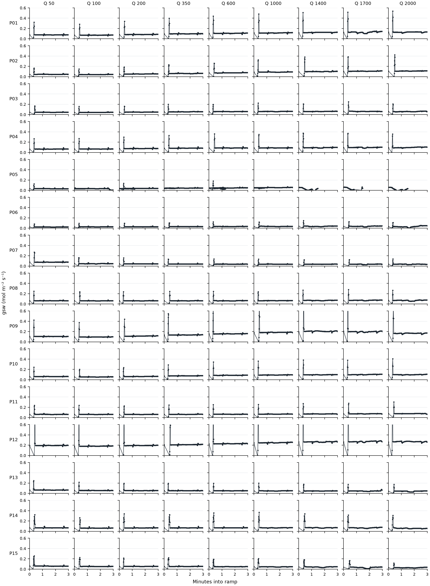

*Phragmites australis, Brownsville cohort, July 24–31, first 3 minutes of every ramp ([points](../outputs/phrag_brownsville_cohort_points.csv), [runs](../data/run_index.csv)), Script: [plot_phrag_gsw_ramp_start_blips.py](../scripts/plot_phrag_gsw_ramp_start_blips.py).*

See the giveaway? If you've worked with plants before, you might notice that they're not this punctual. Each blip lands about 20 seconds into the ramp, right as the CO2 starts climbing. This is the realm of the machine.

This prompted a quick and decisive investigation: this blip coincides with sample H2O briefly reading reference air at the start of each ramp, followed by the dynamic humidity correction (dHs/dt) overshooting as it recovers. Confirmed: it's a machine artifact.

Why does the sample H2O do this? No idea. The software/firmware is closed-source.

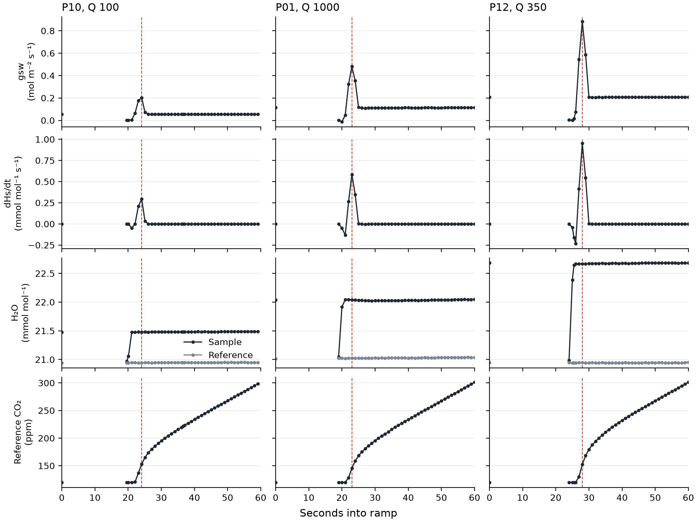

*Three example ramps from the Brownsville cohort ([points](../outputs/phrag_brownsville_cohort_points.csv)), Script: [plot_phrag_gsw_blip_channels.py](../scripts/plot_phrag_gsw_blip_channels.py).*

So where does this leave us? I think my updated beliefs are something like:

- Low CO2 probably *can* help increase gsw but only in some circumstances (e.g. the Morella).
- We saw no meaningful increase in gsw on the Phragmites.
- A follow-up investigation might want to think more carefully about the timing of low-CO2 holds vs. rapid, increasing CO2 ramps.

## Two Kinds Of Leaves: Saturating vs Linear A/Ci

The Phragmites leaves we measured seem to cluster into 2 sorts of shapes that we're calling linear and saturating. This is also strongly correlated with maximum A, but we've chosen to group here by shape rather than scale.

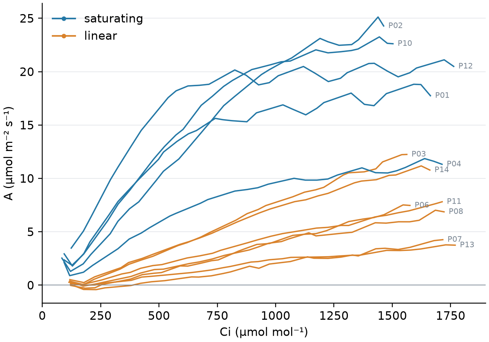

*Phragmites australis, Brownsville cohort, PPFD 1000, median A in 50 ppm Ci bins ([curves](../outputs/phrag_brownsville_cohort_binned_curves.csv)), Script: [plot_phrag_leaf_groups.py](../scripts/plot_phrag_leaf_groups.py).*

The two groups, as chosen above at least, have completely distinct ranges of gsw: 0.036–0.070 (linear) vs 0.091–0.257 (saturating).

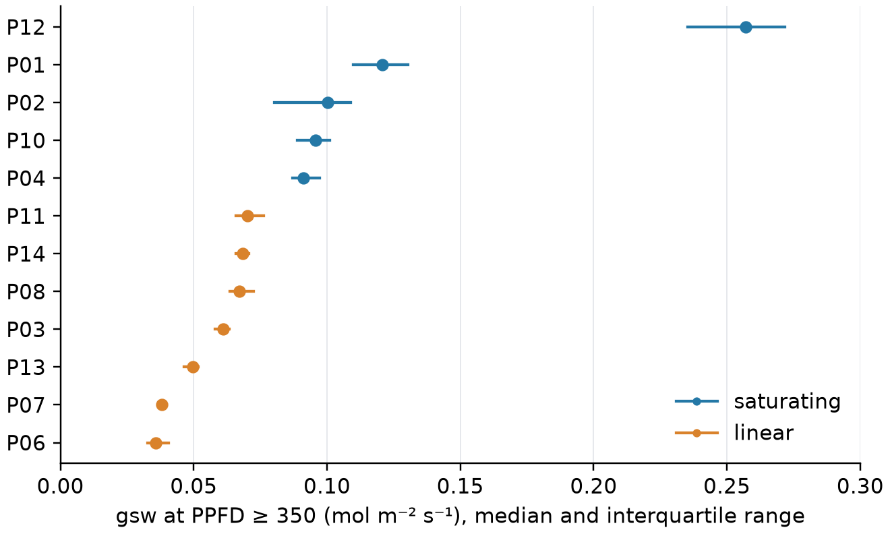

*gsw during ramps at PPFD ≥ 350 ([points](../outputs/phrag_brownsville_cohort_points.csv)), Script: [plot_phrag_leaf_groups.py](../scripts/plot_phrag_leaf_groups.py).*

Fluorometry shows that the linear-shaped leaves are spending 9–21 electrons per CO2 at most light levels. Saturating leaves are only spending about 4–7. This is a disagreement between the gas exchange data and the fluorometry data! If the plants were really operating at the CO2 levels indicated by Ci, we would expect to see about 4.3–4.5.

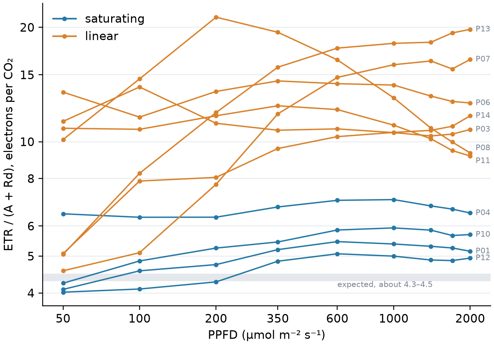

*The two highest-Ci flashes of each ramp (Ci about 1100–1700), Rd = 1 assumed, P02 excluded (overlapping flashes) ([flashes](../outputs/phrag_brownsville_cohort_flashes.csv)), Script: [plot_phrag_leaf_groups.py](../scripts/plot_phrag_leaf_groups.py).*

Why and how could this happen? Either the CO2 levels are lower than Ci indicates, or the electrons are going somewhere that isn't CO2 fixation. Fluorometric calibration isn't a strong enough knob to explain these differences: the linear leaves would need a leaf absorptance of 0.25–0.45.

The "expected" band in the figure above is contingent on a few assumptions, namely:
- We're accepting the LI-6800's default values for electron transport rate scaling. A joint fit of the saturating leaves suggests that's a bit of an overestimate, by about 20%.
- We assume there is no Gm drawdown, and Ci = Cc. This is a bad assumption.

This is likely why the saturating leaves are sitting above the gray band. Even so, 9-21 electrons per CO2 for the linear leaves is a very high number and is different from the saturating leaves, even if our assumptions are imperfect. We suspect that the CO2 isn't reaching Rubisco effectively in those leaves. A quick investigation of a few possible explanations:

- Probably not cuticular conductance. The cuticle would need to account for 85–100% of the measured gsw, 3–6 times the grass median (Duursma et al. 2019). Plus, the required value tracks gsw within each leaf instead of staying constant like one would expect from a cuticle.
- Patchy stomata are a possibility. If you take 80+% of the leaf area at <15% of the stomatal conductance, you can fit some of the linear leaves, but not all (P07 and P13 don't work).
- Gm could be very low. A latent model puts linear leaves at 0.005–0.03 while three of the four saturating leaves are at 0.04–0.11. This would require experimental work to confirm.
- We can't, to our knowledge, distinguish between patchy stomata and Gm from these data and the FvCB model. Measuring at 2% O2 at high CO2, or fluorescence imaging, could.

Ironically, this is the sort of challenge that our low-CO2 design was intended to mitigate! Alas.

## Vcmax Looks Lower Than A Gulf Coast Population

We didn't find any evidence of a difference in Vcmax or Jmax across the elevation/salinity zones we sampled. Not exactly a surprise, given the low across-leaf replication.

But we did compare our Vcmax with an external study on Eurasian haplotype M Phragmites australis (Nguyen et al. 2013) that grew individuals from the Mississippi Delta in a growth chamber in Denmark. We did not sequence our Phragmites, so we can't be certain, but haplotype M is common in the Mid-Atlantic and tolerates salinity well (Saltonstall 2002; Vasquez et al. 2005; Meadows & Saltonstall 2007).

Nguyen used a different methodology than we did: a steady state fit on a LI-6400. They found a much higher apparent Vcmax than we did, and about the same Jmax, though we had a much wider distribution of Jmax values across leaves.

If we correct our leaves with our modeled gm values, the apparent Vcmax does climb closer to the reported Nguyen values. However, if you apply the same correction to Nguyen's values, those actually grow faster than ours. Seems like our Vcmax values are likely to be lower than theirs.

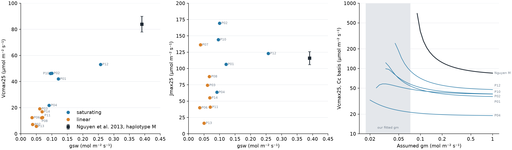

*Left and middle: apparent Vcmax25 and Jmax25 from the Ci-basis joint fit ([fits](../outputs/phrag_brownsville_tier_b_joint_fvcb_fits.csv)), gsw at PPFD ≥ 350 ([points](../outputs/phrag_brownsville_cohort_points.csv)). Nguyen et al. (2013) haplotype M: Vcmax and Jmax from Table 3, gs approximated as Amax / WUEi from Table 2. Right: each Ci-basis Rubisco curve (Ci 100–250) re-read on a Cc basis at an assumed gm and refit ([values](../outputs/phrag_vcmax_gm_sensitivity.csv)); shaded band is our fitted gm range ([fits](../outputs/phrag_brownsville_joint_gm_fits.csv), [fit script](../scripts/fit_phrag_joint_gm.py)). Script: [plot_phrag_vcmax_vs_gsw.py](../scripts/plot_phrag_vcmax_vs_gsw.py).*

## Low-Elevation Leaves Run Higher NPQ

If we examine just the sun leaves, across the very small sample size (4 vs 3 leaves; p = 0.057, the smallest p possible with that n), there seems to be higher Non-Photochemical Quenching in low-elevation (high-salinity) Phragmites leaves compared to their upland, low-salinity counterparts.

This is an interesting result in the context of our field site. Phragmites at the low-elevation end of the range are under much thinner or completely barren pine canopies and are much more exposed to light. Concurrently, they're exposed to a more saline environment: it's plausible they are often in high-light + closed-stomata environments. This would suggest high demand for NPQ: safe dissipation of excess energy that isn't going to photochemistry.

Low elevation leaves are dissipating more energy than high elevation leaves as heat at the same level of electron flow, assuming both absorb the same share of light (we didn't measure absorptance).

This is also independent from the saturating/linear split, which shows up across both ends of the salinity gradient.

Formulated as yield (e.g. Y(NPQ)) the differences are smaller (only 15% higher in low leaves) but again, very small sample size.

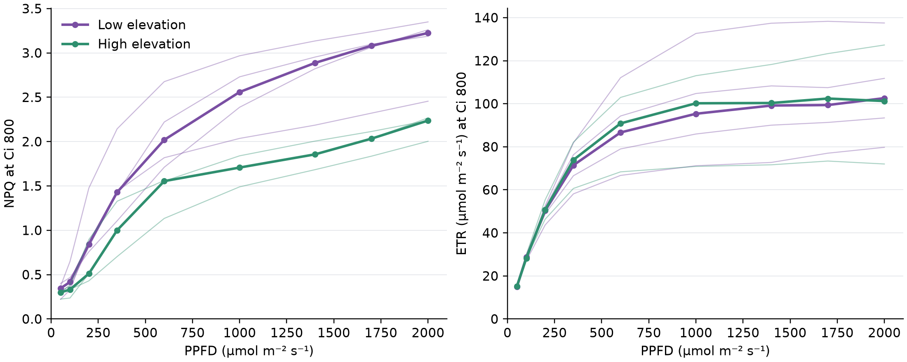

*Sun leaves at a common Ci of 800 ([values](../outputs/phrag_brownsville_cohort_fluorescence_at_common_ci.csv)); thin lines are leaves, thick lines are zone medians. Script: [plot_phrag_npq_zones.py](../scripts/plot_phrag_npq_zones.py).*

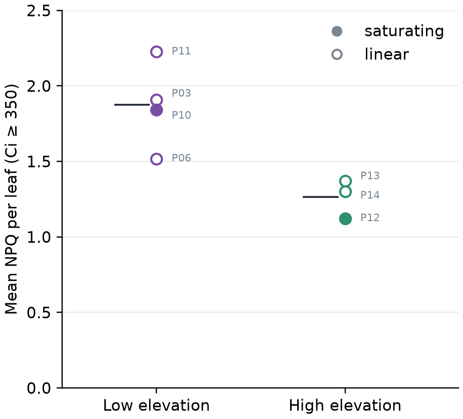

*Mean NPQ over flashes at Ci ≥ 350 ([leaf means](../outputs/phrag_brownsville_npq_overall_leaf_means.csv), [tests](../outputs/phrag_brownsville_npq_overall_significance_tests.csv), [test script](../scripts/test_phrag_brownsville_npq_zone_difference.py)); bars are zone means. Script: [plot_phrag_npq_zones.py](../scripts/plot_phrag_npq_zones.py).*

## Test-Retest

We ran an upland leaf through the same full measurement sequence back-to-back on July 9, 2026. On the 2nd pass, we found that A was much higher at low light: nearly double at PPFD 200, 50% higher at 500, 31% higher at 800, and about the same at very high Q 1700-2000.

gsw and other variables were about the same throughout both runs. This is just more photosynthesis per electron on the second pass. This is a singleton run (a linear-shaped leaf, on our older ramp protocol), but indicates that leaves can be stateful yet the protocol is stateless. That seems like an area of significant opportunity for methods research.

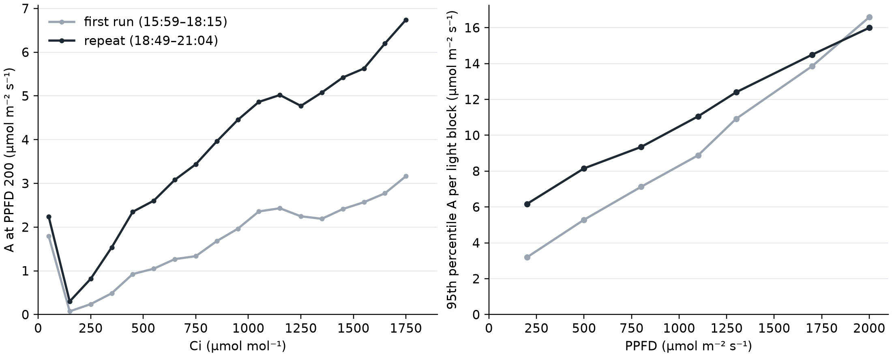

*Upland leaf, July 9 ([first run](../data/2026-07-09_phrag_brownsville_upland), [repeat](../data/2026-07-09_phrag_brownsville_upland_late_repeat), [summary](../outputs/phrag_brownsville_upland_repeat_summary.csv)). Left: median A in 100 ppm Ci bins. Script: [plot_phrag_upland_test_retest.py](../scripts/plot_phrag_upland_test_retest.py).*

## Design Limits

- Light only goes up and CO2 only ramps up. This means both variables are confounded with time. If you tried to get around this with randomized or up-and-down ramps, you'd learn something interesting about statefulness and light induction.
- We have no low-O2 protocol here, so we can't separate gm from other electron sinks, nor can we test directly for TPU.
- Rd in the light would be useful, as would leaf absorptance measurement.
- Cut stems only and small sample size, of course.
